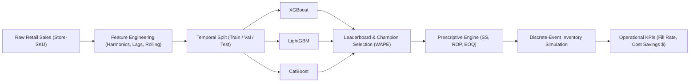

# ACADEMIC PROJECT SYNOPSIS & TECHNICAL PROPOSAL

**Course / Track:** Predictive Modeling & Business Analytics  
**Project Title:** Sales and Revenue Forecasting with Seasonality via Gradient Boosting Frameworks (XGBoost, LightGBM, CatBoost), Applied to Retail Demand Planning and Inventory Optimization  
**Faculty Guide / Mentor:** Dr. P. Sudhakar  
**Date:** October 2026  

---

## Abstract

Omni-channel retail enterprises face significant operational volatility due to multi-layered demand fluctuations, calendar seasonality, promotional uplift, and unpredictable supplier lead times. Suboptimal forecasting directly induces the bullwhip effect, manifesting either as stockouts (revenue loss, customer attrition) or overstocking (excess working capital lock-in, carrying costs, obsolescence).

This project presents an integrated predictive-to-prescriptive decision support framework. On the predictive frontier, we model complex daily retail demand across multi-store, multi-SKU hierarchies using three leading Gradient Boosted Decision Tree (GBDT) frameworks: **XGBoost**, **LightGBM**, and **CatBoost**. Feature engineering incorporates cyclical trigonometric harmonics ($\sin/\cos$ encoding), multi-horizon historical lags, and leakage-free rolling window statistics. Beyond central-tendency predictions, we implement quantile regression ($\tau = 0.90$) to model demand tails under asymmetric risk. 

On the prescriptive frontier, forecasts and empirical error distributions ($\sigma_e$) are synthesized into an operations research inventory control engine computing **Dynamic Safety Stock ($SS$)**, **Reorder Points ($ROP$)**, and **Economic Order Quantities ($EOQ$)**. Through a discrete-event simulation over test horizons, we demonstrate that the proposed ML-driven policy achieves higher On-Time In-Full (OTIF) service levels ($\ge 95\%$) while cutting total supply chain holding and stockout penalty costs relative to traditional static heuristic policies.

---

## 1. Introduction & Problem Statement

Retail inventory management operates at the nexus of customer satisfaction and capital efficiency. Retailers must decide days or weeks in advance what quantities of merchandise to procure from suppliers. 

### 1.1 Core Industry Challenges
1. **Multi-Scale Seasonality:** Demand exhibits concurrent daily, weekly (weekend surges), monthly (paycheck cycles), and annual (holiday/Black Friday peaks) cycles.
2. **Promotional & Price Sensitivity:** Markdown campaigns introduce non-linear demand spikes that violate linear Gaussian assumptions of traditional time-series methods (ARIMA, Holt-Winters).
3. **Decoupling of Forecasts and Inventory Decisions:** In many retail setups, forecasting is performed in isolation from inventory policy, relying on point estimates ($\hat{y}$) that ignore error distributions ($\sigma_e$), inevitably triggering stockouts during sudden demand surges.

---

## 2. Research Objectives

1. **Develop an Automated Feature Pipeline:** Construct calendar, harmonic, historical lag, and rolling statistics features that eliminate look-ahead bias and data leakage.
2. **Systematically Benchmark Tri-GBDT Architectures:** Evaluate XGBoost, LightGBM, and CatBoost in terms of accuracy (WAPE, RMSE, MAE, SMAPE, $R^2$), memory efficiency, and training latency.
3. **Quantify Demand Uncertainty:** Formulate asymmetric pinball loss objectives ($\tau = 0.90$) to establish probabilistic upper demand thresholds.
4. **Formulate Prescriptive Inventory Control Policies:** Implement closed-form operations research formulas for Safety Stock, Reorder Point, and EOQ parameterized by model residual uncertainty.
5. **Conduct Discrete-Event Policy Simulation:** Validate financial impact (holding cost vs. stockout penalty) and service level gains against static rule-of-thumb retail baselines.

---

## 3. Theoretical Framework & Methodology

### 3.1 Gradient Boosted Decision Trees (GBDTs)
GBDTs construct an ensemble of decision trees sequentially:

$$F_m(x) = F_{m-1}(x) + \gamma_m h_m(x)$$

Where $h_m(x)$ fits the negative gradient (pseudo-residuals) of the loss function $\mathcal{L}(y, F_{m-1}(x))$.

- **XGBoost:** Utilizes exact/histogram second-order Taylor expansion of the loss function with explicit L1 ($\alpha$) and L2 ($\lambda$) tree complexity regularization.
- **LightGBM:** Employs leaf-wise tree growth with Gradient-based One-Side Sampling (GOSS) and Exclusive Feature Bundling (EFB), optimizing training speed and memory footprint on large SKU transaction tables.
- **CatBoost:** Implements ordered boosting to suppress prediction shift / target leakage and leverages symmetric oblivious decision trees for rapid vectorized inference.

### 3.2 Evaluation Metric Formulation: WAPE
Unlike MAPE, which divides by $y_i$ (causing infinite values when actual sales are 0), **Weighted Absolute Percentage Error (WAPE)** aggregates total absolute error over total volume:

$$\text{WAPE} = \frac{\sum_{i=1}^n |y_i - \hat{y}_i|}{\sum_{i=1}^n y_i} \times 100\%$$

### 3.3 Dynamic Inventory Math

$$\text{Safety Stock } (SS) = Z_{\alpha} \cdot \sqrt{\bar{L} \cdot \sigma_D^2 + \bar{D}^2 \cdot \sigma_L^2}$$
$$\text{Reorder Point } (ROP) = (\bar{D} \cdot \bar{L}) + SS$$
$$\text{Economic Order Quantity } (EOQ) = \sqrt{\frac{2 \cdot \mathcal{D}_{\text{annual}} \cdot S}{H}}$$

Where:
- $\bar{D}$: Mean forecasted daily demand
- $\sigma_D$: Forecast residual standard deviation ($\sigma_e = \text{std}(y - \hat{y})$)
- $\bar{L}, \sigma_L$: Supplier lead time mean and standard deviation
- $Z_{\alpha}$: Inverse normal CDF value for target service level $\alpha$ ($Z_{0.95} = 1.645$)
- $S$: Order placement transaction cost
- $H$: Annual carrying cost per unit ($h \times \text{COGS}$)

---

## 4. System Implementation Architecture

---

## 5. Expected Deliverables

1. **Modular Python Codebase:** Structured modules for data ingestion, feature generation, model training, evaluation, and inventory optimization.
2. **Comparative Benchmarking Report:** Comprehensive empirical comparison table showing WAPE, RMSE, MAE, R², Pinball loss, and runtime latency.
3. **Interactive Decision Support Tool:** Streamlit application enabling business stakeholders to adjust service levels and supplier lead times in real time.
4. **Final Research Report / Thesis Chapter:** Comprehensive documentation covering mathematical derivations, experimental findings, and managerial recommendations.

---

**Submitted for Academic Review & Approval:**  
**Supervisor:** Dr. P. Sudhakar  
**Department:** Predictive Modeling & Business Analytics  
